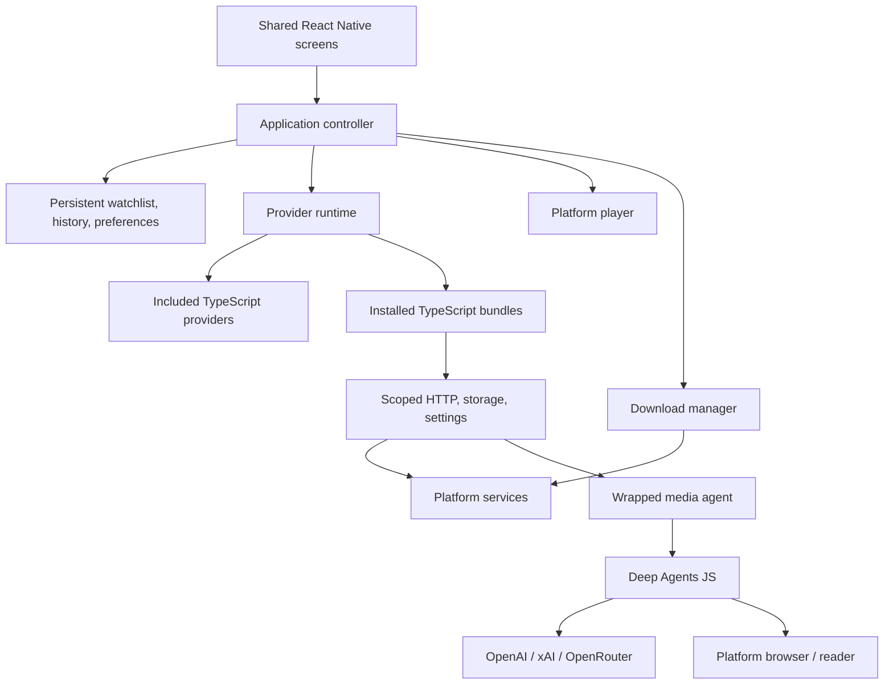

# Architecture

Cinefern 5 replaces Angular, NW.js, Capacitor, SystemJS, and the old core package.
There is one React Native app, one TypeScript provider API, and platform-specific media/file adapters.
No legacy formats are migrated.

| Target      | Interface        | Host and playback                        |
| ----------- | ---------------- | ---------------------------------------- |
| iOS         | React Native     | Expo, expo-video / AVPlayer              |
| Android     | React Native     | Expo, expo-video / ExoPlayer             |
| Apple TV    | React Native TV  | Expo, expo-video / AVPlayer, Siri Remote |
| macOS       | React Native Web | Electron, HTML video, hls.js, dash.js    |
| Windows     | React Native Web | Electron, HTML video, hls.js, dash.js    |
| Linux       | React Native Web | Electron, HTML video, hls.js, dash.js    |
| Web preview | React Native Web | Browser, HTML video, hls.js, dash.js     |

Desktop builds use the shared React Native components through React Native Web; they do not use React Native Windows
or React Native macOS. Electron provides a consistent desktop host including Linux, downloads, network requests, and
always-on-top windows. Mobile builds are native Expo applications.

## Files

- `App.tsx` contains boot, onboarding, screen selection, and the error boundary.
- `src/app-context.tsx` connects navigation, provider lifecycle, watchlists, and playback.
- `src/core` holds platform-independent storage, provider validation/runtime, and download state.
- `src/agent` owns the wrapped Deep Agents service, credentials/settings, model/search adapters, tool boundaries, and portable page reader. See [media agent](media-agent.md).
- `src/screens` and `src/ui` contain the responsive React Native interface.
- `src/player` chooses native or desktop/web playback through Metro platform resolution.
- `src/platform` implements persistence, file picking, networking, downloads, and export.
- `packages/provider-sdk` defines the new provider contract.
- `apps/desktop` contains Electron main/preload code and no runtime npm dependencies.
- `apps/tv` contains the isolated Apple TV Expo project, native configuration, Metro TV resolution, and EAS profiles.
- `src/ui/*.tv.tsx`, `src/player/index.tv.tsx`, and `src/platform/files.tv.ts` specialize remote navigation, playback, and file capabilities.
- `providers/example` is a compilable provider and JSON catalog example.
- `scripts/build-provider.mjs` packages provider source into an installable bundle.

## Persistence

Library snapshots have a version and use serialized asynchronous writes.
Media identity is the pair of provider id and media id, preventing collisions between providers.
History retains up to 500 entries. Continue-watching shows the latest episode for each series, omitting finished items.
Interrupted downloads become retryable after restart.
Uninstalling a provider keeps its saved metadata and history. Offline files can still be played.

Mobile uses AsyncStorage for the library and application documents for files.
Apple TV uses AsyncStorage and purgeable cache storage for downloaded media; see [Apple TV](apple-tv.md) for persistence limits.
Desktop uses renderer storage and app-managed files in Electron's user-data directory.
The browser preview stores downloaded blobs in IndexedDB. Browser quota and CORS restrictions apply.
Progressive files can be downloaded, cancelled, removed, and retried. Retry starts a new transfer; there is no partial-transfer resume.
External subtitles use VTT/SRT cues; native custom subtitle overlays are shown in the in-app player, while embedded
tracks follow the platform's native fullscreen player.

## Desktop boundary

The renderer runs with context isolation, sandboxing, and Node integration disabled.
Preload exposes narrowly scoped IPC operations. The main process verifies the sending frame,
allows HTTP(S) network URLs, rejects arbitrary external protocols, and confines downloaded-file paths.
The production app uses a local custom protocol; it does not depend on a development server or disable browser security.
External navigation is blocked and explicit website links use the system browser.

## Build and verification

Expo's [SDK compatibility table](https://docs.expo.dev/versions/latest/) defines the React/React Native versions.
Native playback follows the [expo-video API](https://docs.expo.dev/versions/latest/sdk/video/).
Electron settings follow its [security guidance](https://www.electronjs.org/docs/latest/tutorial/security).
The lockfile pins the installed dependency tree.

Local automated checks cover persistence, provider identities, permissions, plugin compilation/interpreter execution,
download state, source selection, and subtitle parsing. Mobile bundle export validates both native module graphs and Hermes bytecode.
It does not replace compiling and running a native app on each target.
Unsigned desktop packaging verifies the local release layout. Signing and notarization require release credentials.
